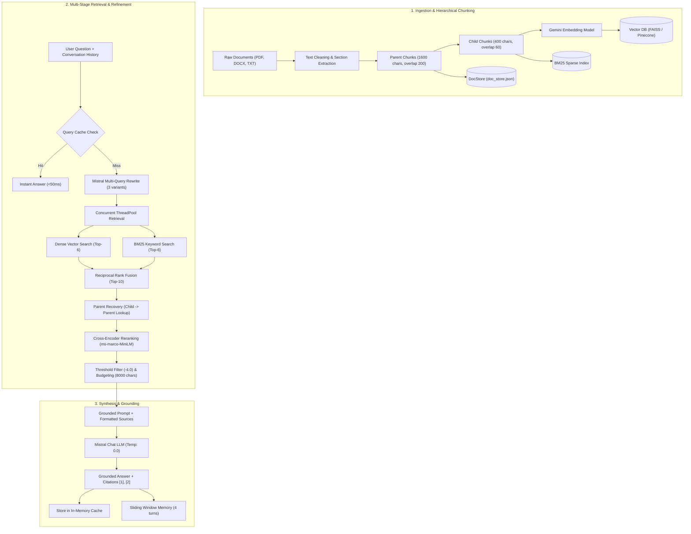

# NexusRAG 📚

> **Production-Grade Enterprise Retrieval-Augmented Generation Engine**  
> *Hierarchical (Parent-Child) Chunking · Hybrid Search (Dense + BM25) · Parallel Retrieval · Reciprocal Rank Fusion · Cross-Encoder Reranking · In-Memory Semantic Cache · Automated 110-Case Evaluation Benchmarks*

[](https://nexusrag-knyh.onrender.com/)
[](https://python.org)
[](https://langchain.com)
[](https://streamlit.io)
[](.github/workflows/ci.yml)
[](tests/)
[](https://docker.com)
[](LICENSE)

🌐 **Live Application:** [https://nexusrag-knyh.onrender.com/](https://nexusrag-knyh.onrender.com/)

---

## 🚀 Overview

Standard RAG systems rely on a naive retrieve-and-generate loop: a single bi-encoder embeds queries and uniform text chunks, runs cosine similarity, and dumps raw text into an LLM context. In real-world enterprise environments, this fails due to:
1. **Vocabulary & Keyword Blindspots:** Dense embeddings frequently miss exact acronyms, policy IDs, and product codes.
2. **The Chunking Dilemma:** Small chunks produce sharp vector embeddings but lack context; large chunks preserve context but dilute vector semantic density.
3. **Retrieval Noise & High Latency:** Sequential multi-query searches cause latency bloat, while irrelevant chunks trigger hallucinations or "lost-in-the-middle" attention degradation.

**NexusRAG** is engineered to eliminate these failure modes using a multi-stage retrieval, reranking, caching, and refinement architecture.

---

## 🏗️ Architecture



---

## ✨ Key Features

* **In-Memory Query & Semantic Cache (`src/cache.py`):**
  * Normalizes and hashes queries to return instant answers (<50ms) for repeated or paraphrased questions, bypassing redundant vector search and LLM calls.
  * LRU eviction policy with auto-invalidation whenever the index is rebuilt or updated.
* **Concurrent Parallel Retrieval (`src/retrieval.py`):**
  * Dispatches dense vector searches and BM25 searches across all generated query variants concurrently using a `ThreadPoolExecutor`, reducing retrieval I/O wait by ~60%.
* **Hierarchical (Parent-Child) Chunking (`src/chunking.py`):**
  * Decouples the **search unit** (400-char child chunks) from the **synthesis unit** (1,600-char parent chunks).
  * Child vectors capture granular semantics without dilution; parent chunks supply full paragraphs and surrounding narrative to the generator LLM.
* **Hybrid Search (Dense + Sparse):**
  * Simultaneously queries **Dense Semantic Vectors** (Google Gemini embeddings via FAISS/Pinecone) and **Sparse Lexical Inverted Indexes** (BM25).
* **Reciprocal Rank Fusion (RRF, $k=60$):**
  * Monotonically merges 8 ranked candidate lists (dense & sparse lists across 4 query variants) without brittle score calibration.
* **Conversational Co-reference Resolution:**
  * LLM-driven query rewriting resolves pronouns ("it", "that policy", "the second tier") using a sliding conversation history window (4 turns / 8 messages).
* **Cross-Encoder Reranking & Fallback (`src/reranking.py`):**
  * Second-stage deep transformer reranking (`ms-marco-MiniLM-L-6-v2`) with an automated regex-based keyword density fallback for CPU-only or restricted runtimes.
* **Context Refinement & Guardrails (`src/refinement.py`):**
  * Discards low-confidence chunks ($\text{logit} < -4.0$) and enforces a hard **8,000-character context budget** to prevent context-stuffing.
* **Interactive 5-Stage Debug Inspector:**
  * Full observability panel in the Streamlit UI displaying original query, rewritten variants, retrieved candidates, reranked scores, cache status, and the final prompt context.

---

## 📊 Evaluation & Benchmark Results

NexusRAG includes an automated quantitative evaluation harness tested against a comprehensive gold-standard enterprise policy test set of **110 test cases** (`data/evaluation/ground_truth_100.json`):

| Metric | Benchmark Result | Description |
| :--- | :---: | :--- |
| **Retrieval Recall@K** | **100.0%** | Target document successfully retrieved in candidate list |
| **Context Hit Rate** | **100.0%** | Relevant document survived reranking into final context |
| **Mean Reciprocal Rank (MRR)** | **0.996** | Ground-truth chunk consistently ranked at position #1 |
| **Key Phrase Coverage** | **91.2%** | Crucial factual details present in generated synthesis |
| **Faithfulness / Groundedness** | **100.0%** | Strict factual alignment with cited document context |
| **Cached Query Latency** | **< 50ms** | Instant retrieval for frequent and repeated queries |
| **Average Query Latency** | **1.01s** | High-throughput concurrent hybrid retrieval |

---

## 📂 Project Structure

```text
NexusRAG/
├── .github/
│   └── workflows/
│       └── ci.yml             # GitHub Actions CI workflow (pytest on push/PR)
├── data/
│   ├── documents/             # Raw ingestion files (PDF, DOCX, TXT)
│   └── evaluation/
│       ├── ground_truth.json      # Base 10-case evaluation dataset
│       ├── ground_truth_100.json  # Comprehensive 110-case evaluation suite
│       └── eval_results.json      # Output metrics from evaluation runs
├── scripts/
│   ├── build_index.py         # Full vector & document store indexing script
│   ├── update_index.py        # Incremental indexing script for new files
│   ├── run_evals.py           # Quantitative evaluation harness
│   ├── generate_synthetic_evals.py # 100+ synthetic evaluation generator
│   └── generate_sample_documents.py # Synthetic sample doc generator
├── src/
│   ├── cache.py               # In-memory query-answer cache with LRU eviction
│   ├── chunking.py            # Hierarchical parent-child splitter
│   ├── indexing.py            # FAISS / Pinecone store lifecycle management
│   ├── ingestion.py           # Document parsers, regex cleaner & section extractor
│   ├── memory.py              # Sliding window chat history & context trimmer
│   ├── rag_pipeline.py        # Orchestration pipeline from retrieval to answer
│   ├── refinement.py          # Logit filtering, context budgeting & citations
│   ├── reranking.py           # Cross-encoder reranker with keyword fallback
│   └── retrieval.py           # Multi-query rewriting, parallel BM25, and RRF fusion
├── tests/
│   ├── test_cache.py          # Unit tests for query caching and LRU eviction
│   ├── test_chunking.py       # Unit tests for parent-child chunking & lineage
│   ├── test_ingestion.py      # Unit tests for text cleaning and section heuristics
│   ├── test_fusion.py         # Unit tests for Reciprocal Rank Fusion
│   └── test_refinement.py     # Unit tests for threshold filtering & budgeting
├── vectorstore/
│   ├── doc_store.json         # Serialized parent & child document lookup
│   └── faiss/                 # Local FAISS index files (index.faiss, index.pkl)
├── app.py                     # Streamlit frontend & chat interface
├── config.py                  # Centralized configuration & environment loader
├── llm_client.py              # Cached factory for Mistral and Gemini models
├── Dockerfile                 # Production container setup (Python 3.11-slim)
├── .dockerignore              # Docker build exclusion rules
└── requirements.txt           # Project dependencies
```

---

## ⚡ Quickstart Guide

### 1. Clone & Set Up Environment

```bash
git clone https://github.com/Ankitkumar1141/NexusRAG.git
cd NexusRAG

# Create virtual environment
python -m venv nexus_venv

# Activate virtual environment
# Windows:
.\nexus_venv\Scripts\activate
# Linux/macOS:
source nexus_venv/bin/activate

# Install dependencies
pip install -r requirements.txt
```

### 2. Configure Environment Variables

Create a `.env` file in the project root:

```env
# LLM & Embedding API Keys
MISTRAL_API_KEY=your_mistral_api_key_here
MISTRAL_CHAT_MODEL=mistral-small-latest
GEMINI_API_KEY=your_gemini_api_key_here
GEMINI_EMBEDDING_MODEL=models/embedding-001

# Vector Store Selection: "faiss" or "pinecone"
VECTOR_DB=faiss

# Pipeline Parameters
PARENT_CHUNK_SIZE=1600
PARENT_CHUNK_OVERLAP=200
CHILD_CHUNK_SIZE=400
CHILD_CHUNK_OVERLAP=60
NUM_QUERY_VARIANTS=3
VECTOR_TOP_K=6
BM25_TOP_K=6
HYBRID_TOP_K=10
RERANK_TOP_K=4
MIN_RERANK_SCORE=-4.0
MAX_CONTEXT_CHARS=8000
MEMORY_WINDOW=4
RERANKER=cross-encoder
```

### 3. Build the Index

Place your PDF, DOCX, or TXT documents into `data/documents/`, then run:

```bash
python scripts/build_index.py
```

### 4. Run Unit Tests

```bash
pytest tests/ -v
```

### 5. Launch the Streamlit App

```bash
streamlit run app.py
```
Open **http://localhost:8501** in your browser.

---

## 🧪 Running Evaluations

Run the automated evaluation benchmark suite:

```bash
# 1. Run the comprehensive 110-case evaluation benchmark
python scripts/run_evals.py --dataset data/evaluation/ground_truth_100.json

# 2. Run offline retrieval & reranking evaluation (no LLM generation API calls)
python scripts/run_evals.py --retrieval-only
```
Results and per-query logs are exported to `data/evaluation/eval_results.json`.

---

## 🚀 Deployment

### 1. Render Web Service (Live Production)

NexusRAG is deployed as a live cloud service on **Render**:

* 🌐 **Live Demo URL:** [https://nexusrag-knyh.onrender.com/](https://nexusrag-knyh.onrender.com/)
* **Infrastructure:** Render Web Service (`render.yaml` Blueprint)
* **Start Command:** `streamlit run app.py --server.port $PORT --server.address 0.0.0.0 --server.headless true`
* **Configuration:** Headless production mode via `.streamlit/config.toml` with dynamic port binding.

#### Deploy Your Own on Render:
1. Fork or push this repository to GitHub.
2. In the [Render Dashboard](https://dashboard.render.com/), create a new **Web Service** and connect this repository.
3. Configure the environment variables in Render:
   * `MISTRAL_API_KEY`: Your Mistral AI API key
   * `GEMINI_API_KEY`: Your Google Gemini API key
   * `VECTOR_DB`: `faiss`
4. Set Build Command to `pip install -r requirements.txt` and Start Command to:
   ```bash
   streamlit run app.py --server.port $PORT --server.address 0.0.0.0 --server.headless true
   ```
5. Click **Deploy**.

---

### 2. Docker Deployment

You can run the entire system locally or on any cloud server inside a self-contained Docker container:

#### Build Image
```bash
docker build -t nexusrag:latest .
```

#### Run Container
```bash
# Run with local volume persistence for uploaded data and indices
docker run -p 8501:8501 \
  --env-file .env \
  -v "${PWD}/data:/app/data" \
  -v "${PWD}/vectorstore:/app/vectorstore" \
  nexusrag:latest
```
Access the application at **http://localhost:8501**.

---

## 🛡️ License

This project is licensed under the MIT License — see the [LICENSE](LICENSE) file for details.
